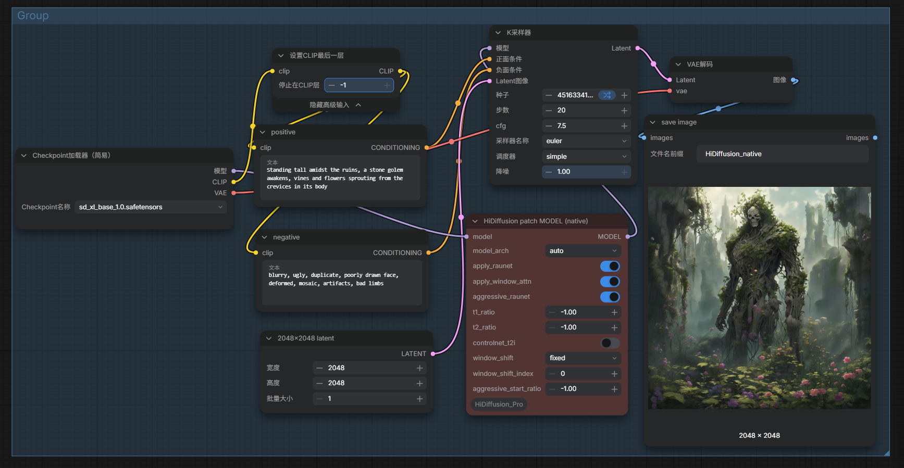

# ComfyUI_HiDiffusion_Pro 

[HiDiffusion](https://github.com/megvii-research/HiDiffusion)
---

# Update
* 使用agent 重新封装了HiDiffusion 代码/ used agent to encapsulate HiDiffusion code

# Installation
  1.1 In the .\ComfyUI\custom_nodes directory, run the following:   
  ``` 
  git clone https://github.com/smthemex/ComfyUI_HiDiffusion_Pro.git   
  ```

# Model
* SDXL or sd1.5
```
├── ComfyUI/models/photomaker
|         ├── sd_xl_base_1.0.safetensors
|         ├── v1-5-pruned-emaonly-fp16.safetensors

```
# example

 

# Citation
``` 
@article{zhang2023hidiffusion,
  title={HiDiffusion: Unlocking Higher-Resolution Creativity and Efficiency in Pretrained Diffusion Models},
  author={Zhang, Shen and Chen, Zhaowei and Zhao, Zhenyu and Chen, Yuhao and Tang, Yao and Liang, Jiajun},
  journal={arXiv preprint arXiv:2311.17528},
  year={2023}
}
```